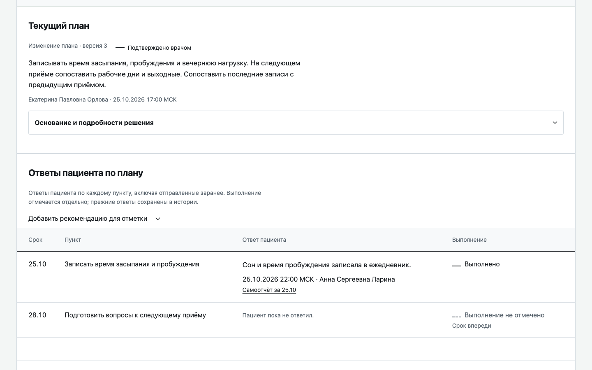
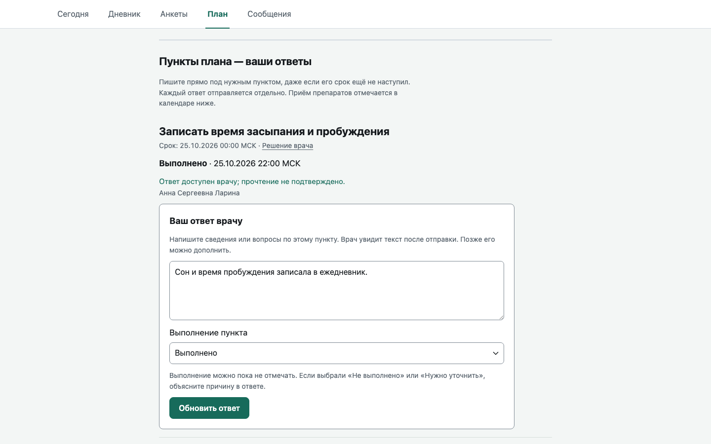
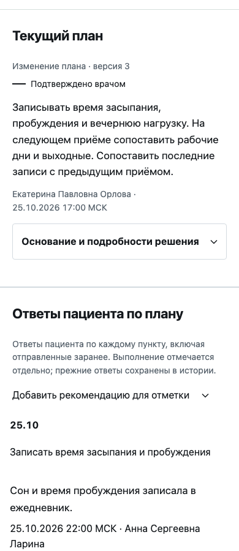
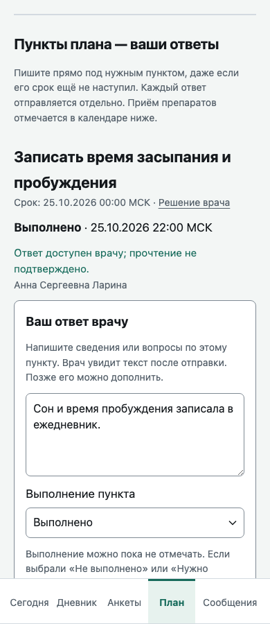

<div align="center">

# Клинический компас

**Психиатр и пациент между приёмами видят одну и ту же историю.**

Веб-сервис для амбулаторной психиатрии: пациент дома отмечает самочувствие и заполняет анкеты,
врач перед повторным приёмом за минуту понимает, что изменилось, и сам решает, что делать дальше.


</div>

> **Статус.** Конкурсный прототип. Все пациенты и истории в нём вымышленные, реальные данные вводить нельзя.
> Сервис не ставит диагнозов, не назначает лечение и не является медицинским изделием.
> Репозиторий закрытый, права на код зарезервированы (см. [«Права»](#права-и-статус)).

---

## Как это выглядит

Один и тот же пункт плана у врача и у пациента. Слева кабинет врача, справа кабинет пациента.

<table>
  <tr>
    <td width="50%"></td>
    <td width="50%"></td>
  </tr>
  <tr>
    <td align="center"><sub>Врач: план, подтверждённый им самим, и ответы пациента рядом с каждым пунктом</sub></td>
    <td align="center"><sub>Пациент: отвечает прямо под нужным пунктом, даже если срок ещё не наступил</sub></td>
  </tr>
</table>

На телефоне оба кабинета работают полноценно, это не урезанная версия:

<table>
  <tr>
    <td width="50%" align="center"></td>
    <td width="50%" align="center"></td>
  </tr>
</table>

---

## Зачем это нужно

Между приёмами проходят недели. Врач узнаёт о них из памяти пациента: что было со сном, принимал ли он препарат,
стало ли хуже после смены дозы. Пациент помнит не всё, а то, что записал, часто теряется.

«Клинический компас» собирает эту часть в одну цепочку:

```
исходные сведения → самоотчёт и анкеты дома → сводка к приёму → решение врача → наблюдение и связь
```

Успех измеряется двумя вещами. Врач за минуту видит, что изменилось и кому нужно внимание, и для каждого факта
знает, откуда он взялся. Пациент за несколько касаний отмечает самочувствие и видит, что запись дошла.

---

## Что умеет

### Пациент

- **Сегодня.** Главное действие видно сразу, на телефоне без прокрутки. Последний утверждённый врачом план и недельный календарь приёма препаратов.
- **Самоотчёт.** Самочувствие, жалобы, нежелательные явления. Черновик хранится на сервере, повторная отправка и конфликт вкладок обработаны, подтверждение показывается только после ответа сервера.
- **План.** Ответ пишется под тем пунктом, которого он касается. Каждый ответ отправляется отдельно, прежние версии остаются в раскрываемой истории.
- **Препараты.** Отметка каждого приёма, в том числе частичной дозы. По каждому препарату независимые отметки: есть эффект, нет эффекта, нежелательные явления, у каждой своё описание.
- **Анкеты.** DASS-42, PHQ-9 и GAD-7 по приглашению врача. После отправки пациент получает квитанцию, но не видит сумм баллов и интерпретации.
- **Дневник и сообщения.** График субъективного самочувствия и переписка с врачом.

### Врач

- **Список пациентов.** Режимы «Все» и «Нужно проверить». Рядом с каждым пациентом конкретная причина и ссылка на запись, из которой она следует.
- **Единая карточка** с выбором периода. Всё, что накопилось с прошлого приёма, на одной странице.
- **План.** Текущий текст и календарь первыми, основание решения и история раскрываются отдельно. Расписание препаратов вступает в силу только после отдельного подтверждения врача.
- **Ответы по плану.** Таблица приёма за шесть недель, переход к дню с пропуском. Пропуск и отсутствие отметки показаны как разные вещи.
- **Анкеты.** Исходные ответы, суммы по шкалам, графики, история. Незаполненный пункт не превращается в ноль.
- **Первый приём, сообщения, приглашения.** Пациента можно пригласить из бокового меню на любом экране, а без JavaScript есть отдельная страница.

---

## Принципы, на которых всё построено

1. **Врач решает, сервис показывает.** Назначение, изменение терапии, направление и изменение плана происходят только после подтверждения врача на сервере.
2. **У каждого факта есть происхождение.** Кто, когда и что именно сказал. Исправление добавляется новой записью, прежние не стираются.
3. **Неизвестное видно так же ясно, как известное.** Отсутствие данных не выглядит как «всё хорошо». Противоречия не сглаживаются. Статусы различимы не только цветом, но и текстом, формой и значком.
4. **Выполнение и самоотчёт это разные записи.** Сервис не считает пункт выполненным только потому, что пациент что-то написал.
5. **Короткий путь, безопасный повтор.** Одно главное действие на экране, ошибку можно исправить, повторное нажатие ничего не ломает.

---

## Анкеты и права на них

| Анкета | Источник | Статус |
|---|---|---|
| DASS-42 | Lovibond & Lovibond, 1995; русская версия И. М. Фаттахова и Е. А. Горобец | Текст, порядок и ответы не менялись |
| PHQ-9 | Русская версия для России | Результат только врачу |
| GAD-7 | Русская версия для России | Результат только врачу |

Подробности о происхождении текстов, возрасте применимости и подсчёте суммы: [docs/clinical/scales-rights.md](docs/clinical/scales-rights.md).

---

## Технологии

- **Python 3.13**, **Flask 3.1** и Jinja2, сервер **waitress**
- **SQLite** с полнотекстовым поиском (FTS5), миграции в коде
- Собственный CSS и обычный JavaScript, без фреймворков и сборки
- Строгая политика `Content-Security-Policy: default-src 'self'`: никаких CDN, внешних шрифтов, встроенных скриптов и стилей. Шрифты лежат в репозитории
- Формы работают без JavaScript. Ничего не хранится в `localStorage` и `sessionStorage`
- Доступность: WCAG 2.2 AA, ширина от 360 до 1920 пикселей, видимый фокус, работа с клавиатуры, уважение `prefers-reduced-motion`
- Для запуска продукта не нужны ИИ-сервисы, внешние API и платные подписки

Зависимостей всего восемь, они закреплены в [apps/requirements.lock](apps/requirements.lock).

---

## Быстрый старт

Нужны Python 3.13 с поддержкой SQLite FTS5 и `make`.

```bash
make setup          # виртуальное окружение и зависимости
make migrate        # создать базу var/compass.sqlite3
make seed           # вымышленные случаи
umask 077
.venv/bin/python -m apps.compass seed-accounts > var/demo-credentials.json
make run            # сайт на http://127.0.0.1:8000
```

Логины и случайные пароли попадут в `var/demo-credentials.json`. Эта папка в Git не попадает, потерять файл не стоит:
повторный запуск `seed-accounts` пароли не восстанавливает.

В отдельном терминале запустите обработчик фоновых событий:

```bash
make worker
```

### Через Docker

```bash
docker compose up --build -d --wait
```

Сайт откроется на `127.0.0.1:8000`, база хранится в томе `compass-data` и переживает перезапуск.
Если порт занят: `COMPASS_PORT=8001 docker compose up --build -d --wait`.

### Проверки

```bash
make test           # модульные тесты
make check          # тесты, перезапуск, проверка зависимостей и синтетических данных
```

Полная инструкция, отдельная база и порт, восстановление: [docs/RUNBOOK.md](docs/RUNBOOK.md).

---

## Устройство репозитория

```
apps/compass/        сайт: маршруты, шаблоны, стили, скрипты, бизнес-логика
apps/tests/          модульные тесты и проверка перезапуска
tools/               заполнение вымышленными историями, проверки, оценки
data/                синтетические наборы и материалы для проверок
docs/                архитектура, продукт, дизайн, клиника, эксплуатация
plan/                дорожная карта по срезам
memory/              текущее состояние работы, решения, блокеры
evidence/            доказательства приёмки каждого среза
```

Подробнее:

- [docs/architecture](docs/architecture): доступ, модель данных, API, анкеты, планы, фоновые задачи
- [docs/design](docs/design): дизайн-документы, [DESIGN.md](DESIGN.md) с системой интерфейса
- [PRODUCT.md](PRODUCT.md): пользователи, назначение, границы и принципы продукта
- [docs/demo/psychiatrist-patient-walkthrough.md](docs/demo/psychiatrist-patient-walkthrough.md): сценарий показа от врача к пациенту

---

## Как ведётся работа

Проект разбит на срезы. Один срез это одна законченная часть: реализация, проверка, запись в память, коммит и тег
`slice/<номер>`. Текущее состояние всегда лежит в [memory/STATE.json](memory/STATE.json), а не в старых описаниях.

С чего начать новому участнику:

1. [AGENTS.md](AGENTS.md) — правила работы с проектом
2. [START_HERE.md](START_HERE.md) — подробный вход в проект
3. [plan/ROADMAP.md](plan/ROADMAP.md) — все срезы и зависимости
4. [memory/DECISIONS.md](memory/DECISIONS.md) и [memory/BLOCKERS.md](memory/BLOCKERS.md) — принятые решения и открытые вопросы

Система поддержки решений из проекта убрана по поручению заказчика и не возобновляется. Клинические правила заблокированы,
интерфейс не изображает их работающими.

---

## Данные и безопасность

- Все пациенты, врачи и истории вымышленные. Реальных пациентских данных в репозитории нет, вводить их нельзя.
- База (`var/`), пароли, `.env` и приватные данные исключены из Git.
- Клиническое внедрение требует отдельных разрешений и доказательств. Апробации на людях не проводилось, метрик эффективности нет.

---

## Права и статус

Проект сделан для конкурса. Лицензия на использование не выдана: все права сохранены за автором, а условия конкурса
не разрешают публичный репозиторий, поэтому он закрытый. Сторонние материалы, шрифты и тексты анкет перечислены
в [docs/compliance/third-party.md](docs/compliance/third-party.md).
